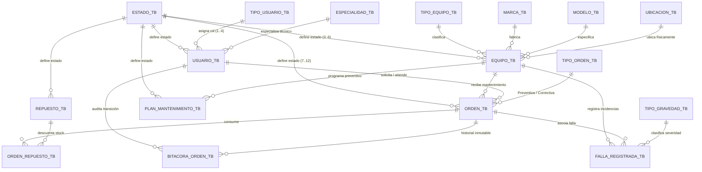

# Sistema de Gestión de Mantenimiento de Equipos

[](https://github.com/Sojo506/mantenimiento-equipos/actions/workflows/ci.yml)


Proyecto Académico para el curso **SC-701 Programación Avanzada Web**  
**Universidad Fidélitas** — **Avance 2 (Semana 12) / Entrega Final (Semana 15)**  

---

## 1. Descripción del Sistema

El **Sistema de Gestión de Mantenimiento de Equipos** es una plataforma web empresarial compuesta por un backend RESTful (**`MantenimientoApi`**) en **Arquitectura Limpia de 4 capas** y un frontend desacoplado en **ASP.NET Core MVC (`Web-Mantenimiento`)**. Permite administrar el parque de maquinaria, órdenes de trabajo preventivas y correctivas, control de inventario de repuestos con alertas de stock mínimo, reporte de fallas con transición automática a estado de riesgo (**RN-03**), predicción de probabilidad de falla a 30 días con **ML.NET**, bitácora de auditoría inmutable y exportación de reportes analíticos en formato **CSV**.

---

## 2. Arquitectura de la Solución

```
┌─────────────────────────────────────────────────────────────────────────┐
│                  Web-Mantenimiento (ASP.NET Core MVC)                   │
│  (IHttpClientFactory + JwtDelegatingHandler + Sesión Cookie HttpOnly)   │
└────────────────────────────────────┬────────────────────────────────────┘
                                     │ HTTP / JSON / CSV (Bearer JWT)
                                     ▼
┌─────────────────────────────────────────────────────────────────────────┐
│                       Capa de API (MantenimientoApi)                    │
│   (Controllers REST, JWT Auth, Scalar OpenAPI, RFC 7807, ETag / 304)    │
└────────────────────────────────────┬────────────────────────────────────┘
                                     │ referencia
                                     ▼
┌─────────────────────────────────────────────────────────────────────────┐
│                              Capa de Flujo                              │
│     (Lógica de Negocio, Máquina de Estados, Reglas RN, ML.NET 4.0)      │
└────────────────────────────────────┬────────────────────────────────────┘
                                     │ referencia
                                     ▼
┌─────────────────────────────────────────────────────────────────────────┐
│                               Capa de DA                                │
│  (MantenimientoDbContext, Fluent API 3FN, Repositorios, Migraciones, SP)│
└────────────────────────────────────┬────────────────────────────────────┘
                                     │ referencia
                                     ▼
┌─────────────────────────────────────────────────────────────────────────┐
│                          Capa de Abstracciones                          │
│         (Entidades, DTOs, Interfaces DA/Flujo, Excepciones, Hash)       │
└─────────────────────────────────────────────────────────────────────────┘
```

Para conocer en detalle las decisiones arquitectónicas y de seguridad, consulte [DECISIONES.md](file:///home/sojo506/Documents/University/PrograAvanzadaWeb/mantenimiento-equipos/DECISIONES.md).

---

## 3. Diagrama Entidad-Relación (Modelo Relacional en 3FN)



---

## 4. Tabla de Cumplimiento y Trazabilidad (Sección 5)

| Código / Módulo | Descripción del Requisito / Regla de Negocio | Implementación en Backend (`MantenimientoApi`) | Implementación en Frontend (`Web-Mantenimiento`) | Pruebas Automatizadas (`Flujo.Tests` / `API.Tests`) |
| :--- | :--- | :--- | :--- | :--- |
| **RN-01** | Escalamiento automático de órdenes críticas sin pasar a `En Proceso` dentro de `MaxHorasCriticaSinAtender` (4 horas). | `ProcesadorReglasAutomaticas` (`BackgroundService`) + `ServicioOrdenDeTrabajo.EscalarCriticasSinAtenderAsync` | `Views/Ordenes/BandejaSupervisor.cshtml` + botón de ejecución inmediata | `RN01_OrdenCriticaSinAtenderMasDelLimite_SeEscalaYQuedaRegistradaEnBitacora` |
| **RN-02** | Cierre de orden exige `TiempoInvertido > 0` y al menos un repuesto o justificación `SinRepuestos`. | `ServicioOrdenDeTrabajo.CambiarEstadoAsync` | `Views/Ordenes/_OrdenAcciones.cshtml` | `CambiarEstadoAsync_ACerradaSinRepuestosNiJustificacion_LanzaReglaNegocioException_RN02` |
| **RN-03** | Al acumular `>= 3` fallas en los últimos 6 meses, el equipo pasa automáticamente a estado `En Riesgo` (`IdEstado = 5`). | `ServicioFalla.RegistrarAsync` + `FallasController` | `FallasController` + `Views/Fallas/Crear.cshtml` | `RegistrarAsync_TerceraFallaEnUltimos6Meses_CambiaEstadoEquipoAEnRiesgo_RN03` |
| **RN-04** | Un equipo `Dado de Baja` no admite órdenes, fallas ni planes; no se permite más de una orden correctiva abierta simultánea por equipo. | `ServicioOrdenDeTrabajo.CrearAsync` + `ServicioFalla` + `ServicioPlanMantenimiento` | `OrdenesController.Crear` + `FallasController.Crear` + `PlanesController.Crear` | `CrearAsync_CorrectivaConOrdenAbiertaExistente_LanzaReglaNegocioException_RN04` |
| **RN-05** | Descuento automático de stock al asignar repuestos; prohibición de stock negativo. | `ServicioOrdenDeTrabajo.AsignarRepuestoAsync` + `ServicioRepuesto` | `RepuestosController` + `OrdenesController.AsignarRepuesto` | `AsignarRepuestoAsync_StockInsuficiente_LanzaReglaNegocioException_RN05` |
| **RN-06** | Generación automática de órdenes preventivas al vencer `ProximaFecha` del plan y reprogramación según `Frecuencia`. | `ProcesadorReglasAutomaticas` (`BackgroundService`) + `ServicioPlanMantenimiento.GenerarOrdenesPreventivasAsync` + `PlanesController` | `PlanesController` + `Views/Planes/Index.cshtml`, `Crear.cshtml`, `Editar.cshtml` | `RN06_PlanVencido_GeneraOrdenPreventivaYReprogramaElPlan` |
| **RN-07** | Un técnico no puede tener más de `MaxOrdenesEnProcesoPorTecnico` (3) órdenes en estado `En Proceso` simultáneamente. | `ServicioOrdenDeTrabajo.CrearAsync` / `CambiarEstadoAsync` / `AsignarTecnicoAsync` | `OrdenesController.BandejaTecnico` / `BandejaSupervisor` | Validación de umbral en `ServicioOrdenDeTrabajoReglasTests` |
| **RN-08** | Máquina de estados estricta y cálculo automático de `FechaLimite` según prioridad (`Critica`, `Alta`, `Media`, `Baja`). | `ServicioOrdenDeTrabajo` (`TransicionesValidas`) | `Views/Ordenes/Detalle.cshtml` | `CambiarEstadoAsync_TransicionInvalidaDeAbiertaAEnProcesoDirecto_LanzaConflictoException_RN08` |
| **RN-09** | Una orden en estado `Cerrada` (11) es estrictamente inmutable y la bitácora no permite edición ni borrado. | `ServicioOrdenDeTrabajo.ActualizarAsync` + `RepositorioBitacoraOrden` | `Views/Ordenes/Bitacora.cshtml` | `ActualizarAsync_OrdenCerradaEsInmutable_LanzaConflictoException_RN09` |
| **Seguridad JWT + Roles** | Login con PBKDF2-SHA256, emisión de JWT Bearer, políticas por rol (`Administrador`, `Supervisor`, `Tecnico`, `Solicitante`). | `AuthController`, `AuthServicio`, `[Authorize(Roles=...)]` | `AccountController`, `JwtDelegatingHandler`, `[AutorizacionSesion]`, `_Layout.cshtml` | `AuthYProblemDetailsIntegrationTests` (`401`, `403`, `200`) |
| **Concurrencia y Caché** | Tokens `RowVersion`, encabezados `ETag` (`304 Not Modified`) e `If-Match` (`409 Conflict`). | `EquiposController`, `RepuestosController`, `OrdenesController` | `ApiClientBase` (`If-Match`), `RepuestosController.Editar` | `ActualizarAsync_ConcurrenciaDesactualizada_LanzaConflictoException` |
| **ML.NET (30 días)** | Predicción de probabilidad de falla a 30 días con clasificación binaria (`SdcaLogisticRegression`). | `ServicioPrediccionFalla` + `GET /api/equipos/{codigo}/prediccion` | Tarjeta ML.NET en `Views/Equipos/Detalle.cshtml` | `PredecirFallaEquipoAsync_EquipoConAltaReincidencia_RetornaProbabilidadMayorAEquipoSano` |
| **Reportes CSV + SP** | 4 reportes descargables en CSV incluyendo consumo del SP `sp_ReporteConsumoRepuestosPorPeriodo`. | `ServicioReportes` + `ReportesController` | `ReportesController.DescargarCsv` (`FileResult`) + `Views/Reportes/Index.cshtml` | `GenerarCsvConsumoRepuestosAsync_DatosValidos_GeneraCsvConEncabezadosYFilas` |
| **Tablero Dinámico** | Indicadores KPI con actualización asíncrona vía `JsonResult` y vista parcial. | `TableroController` + `ServicioTablero` | `TableroController.MetricasJson` / `ResumenParcial` + `Views/Home/Index.cshtml` | Endpoints integrados en `API` y `Web` |

---

## 5. Aplicación de Principios SOLID

1. **S — Single Responsibility Principle (Responsabilidad Única):** Cada servicio de la capa `Flujo` (`ServicioEquipo`, `ServicioRepuesto`, `ServicioOrdenDeTrabajo`, `ServicioFalla`, `ServicioPrediccionFalla`, `ServicioReportes`, `ServicioUsuario`, `AuthServicio`) encapsula un único subdominio de negocio, separando la persistencia (`DA/Repositorios`), el transporte HTTP (`API/Controllers`) y el manejo transversal de errores (`ManejadorExcepcionesGlobal`).
2. **O — Open/Closed Principle (Abierto/Cerrado):** El pipeline de errores basado en `IExceptionHandler` y la jerarquía `ExcepcionBase` (`ReglaNegocioException`, `NoEncontradoException`, `ConflictoException`, `NoAutorizadoException`) permiten incorporar nuevas reglas o excepciones de dominio sin modificar el middleware HTTP.
3. **L — Liskov Substitution Principle (Sustitución de Liskov):** Todos los clientes HTTP en `Web-Mantenimiento` heredan de `ApiClientBase` y las implementaciones de repositorios cumplen estrictamente sus contratos en `Abstracciones/Interfaces/DA`, pudiendo sustituirse de forma transparente por dobles de prueba en memoria.
4. **I — Interface Segregation Principle (Segregación de Interfaces):** En lugar de un repositorio genérico monolítico, los contratos están segregados según las capacidades de cada entidad (por ejemplo, `IRepositorioBitacoraOrden` solo declara `ObtenerHistorialPorOrdenAsync` y `RegistrarAsync`, impidiendo por compilación cualquier intento de actualizar o eliminar registros de auditoría).
5. **D — Dependency Inversion Principle (Inversión de Dependencias):** Los controladores dependen exclusivamente de abstracciones de `Flujo` (`IServicio*`), y los servicios de `Flujo` dependen de abstracciones de `DA` (`IRepositorio*`) y `IOptions<ReglasNegocioOptions>`.

---

## 6. Configuración Local (Base de Datos y User Secrets)

### 6.1. Configurar Secretos Locales (`MantenimientoApi`)
```bash
dotnet user-secrets set "ConnectionStrings:Default" "Server=(localdb)\mssqllocaldb;Database=MantenimientoEquiposDb;Trusted_Connection=True;MultipleActiveResultSets=true;TrustServerCertificate=True" --project MantenimientoApi/API/API.csproj
```

### 6.2. Aplicar Migraciones y Semilla en SQL Server Local
```bash
dotnet ef database update --project MantenimientoApi/DA/DA.csproj --startup-project MantenimientoApi/API/API.csproj
```

### 6.3. Usuarios de Prueba (Semilla en `MantenimientoSeedData.cs`)

| Identificación | Nombre Completo | Rol | Correo Electrónico | Contraseña |
| :--- | :--- | :--- | :--- | :--- |
| `USR-001` | Carlos Mora Soto | **Administrador** | `admin@mantenimiento.com` | `Admin123!` |
| `USR-002` | Elena Vargas Castro | **Supervisor** | `supervisor@mantenimiento.com` | `Super123!` |
| `USR-003` | Javier Rojas Méndez | **Tecnico** | `tecnico1@mantenimiento.com` | `Tecnico123!` |
| `USR-004` | Andrés Navarro Pérez | **Tecnico** | `tecnico2@mantenimiento.com` | `Tecnico123!` |
| `USR-005` | María Solano Chaves | **Solicitante** | `solicitante@mantenimiento.com` | `Solicitante123!` |
| `USR-006` | Roberto Gómez Alvarado | **Solicitante** | `solicitante2@mantenimiento.com` | `Solicitante123!` |

---

## 7. Compilación, Ejecución y Pruebas

```bash
# 1. Compilar Backend (API + Capas + Tests)
dotnet build MantenimientoApi/MantenimientoApi.slnx --configuration Release

# 2. Compilar Frontend MVC (Web-Mantenimiento)
dotnet build Web-Mantenimiento/Web-Mantenimiento.slnx --configuration Release

# 3. Ejecutar Suite Completa de Pruebas (62 pruebas: 47 en Flujo.Tests + 15 en API.Tests)
dotnet test MantenimientoApi/MantenimientoApi.slnx --configuration Release

# 4. Iniciar API (puerto 5237 por defecto)
dotnet run --project MantenimientoApi/API/API.csproj

# 5. Iniciar Web MVC (en otra terminal)
dotnet run --project Web-Mantenimiento/Web-Mantenimiento/Web-Mantenimiento.csproj
```

---

## 8. Declaración de Uso de Inteligencia Artificial

Durante el desarrollo del proyecto se emplearon herramientas de asistencia basadas en Inteligencia Artificial bajo supervisión técnica del equipo para:
- **Generación de datos semilla (`MantenimientoSeedData.cs`):** Estructuración de las 32 órdenes de trabajo iniciales, bitácoras y catálogos paramétricos coherentes con el dominio industrial/hospitalario.
- **Esqueleto de pruebas automatizadas (`Flujo.Tests`):** Asistencia en la redacción de casos de prueba unitarios con `xUnit` y `Moq` y pruebas de integración con `WebApplicationFactory`, validados y ajustados contra las reglas de negocio reales del sistema.
- **Revisión de documentación técnica y formato Markdown/Mermaid:** Estructuración del diagrama ER, tabla de trazabilidad y registro de decisiones arquitectónicas (`DECISIONES.md`).

Todo el código fuente, modelo relacional en 3FN, lógica de negocio, seguridad JWT y vistas Razor fueron revisados, probados y verificados localmente por los integrantes del equipo.
